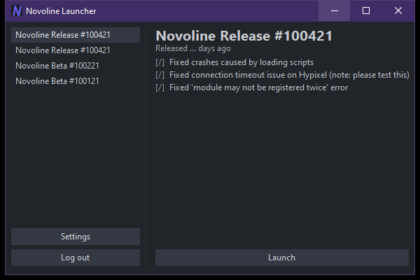

# Novoline Launcher

一个纯 Win32 / GDI+ 编写的 Minecraft 启动器，界面按参考图重绘。无 Electron、无 .NET、无 Qt、无 Python、无 VC++ 运行库，单个 `exe` 即可运行。



## 直接运行

双击：

```
dist\NovolineLauncher.exe
```

要求：Windows 10 / 11 x64。

- **界面本身**只使用 Windows 自带的 `kernel32 / user32 / gdi32 / gdiplus / shell32 / advapi32 / dwmapi` 等系统组件。
- 不依赖 VC++ Redistributable，不依赖 .NET，不依赖任何第三方 DLL，也没有外部皮肤/图片/字体文件。
- 程序内嵌了图标、Manifest 和版本信息。
- 启动 Minecraft 时如果目标 `java` 目录不存在运行时，启动器会先下载 Java 17。

## 功能

- 使用 **Win32 原生标题栏**：窗口标题、标题栏图标、最小化 / 最大化 / 关闭按钮全部由 Windows 系统绘制，不使用自绘标题栏元素。
- 标题栏颜色：Windows 11 通过 DWM 设置为与客户区背景相同的 `#212429`；Windows 10 不支持逐窗口设置标题栏颜色，保持系统原生强调色。
- 应用图标提取自 OpenNovoline 主菜单的 `novoline_blue.png`，并按 `#35314D` 的色相整体偏移（保留原图明暗与饱和度），生成 16 / 20 / 24 / 32 / 40 / 48 / 64 / 96 / 128 / 256 多尺寸 ICO；任务栏、标题栏和资源管理器会按实际 DPI 选择对应尺寸。
- 客户区保留参考图的深色布局；左侧版本列表使用原生 `LISTBOX`，所有按钮使用原生 `BUTTON` 控件（Settings / Log out / Launch / Open / Detect / - / + / Done），没有自绘按钮或列表。
- 所有按钮与窗口边缘、侧边栏分割线保持 10px 间距；按钮带 1px 浅色描边，并在 hover / 按下 / 禁用时切换描边与填充色。
- 所有界面元素以 Windows 100%（96 DPI）标准尺寸为基准：正文 12px、标题 20px、按钮高度 24px、列表项使用原生高度。
- 窗口支持拖动原生标题栏、双击标题栏最大化、边缘缩放、最小化 / 最大化 / 还原 / 关闭。
- 高 DPI 感知（PerMonitorV2），根据屏幕工作区自动缩放，避免界面超出屏幕。
- 启动时从 `https://github.com/M1CK3Y0908/novoline-rat-versions/raw/refs/heads/main/versions.rat` 获取版本列表和右侧发行说明，使用后台线程下载并解析，不阻塞界面。
- 数据尚未返回时，左侧显示 `Loading...`，右侧显示加载提示；不会显示任何本地内置版本列表。
- 网络不可用或数据解析失败时，保持列表为空并显示错误信息，`Launch` 按钮禁用。
- 左侧版本条目可切换，右侧标题和发行说明随选择更新。
- `Settings`：显示游戏目录、Java Path、内存和离线档案；可打开游戏目录、浏览选择 Java、调整内存。
- 启动按钮直接显示状态：`Launch`、`Waiting for the game`、`Running`、`Shutdown`、`Retry`。
- 启动按钮带图标：启动/重试为绿色填充、深绿描边的等边三角，图形高度与文字字高一致；等待状态只显示文字，不显示加载图标；关闭为红色 #FF3B30 电源符号，按 80% 大小绘制并向上偏移。
- 启动按钮上方有 5px 状态色条：平时隐藏；点击启动后显示主题色流光并显示 `Waiting for the game`，检测到游戏窗口后变为绿色呼吸效果和 `Running`，失败为红色流光。
- `Log out`：切换为离线档案 `Player`。
- `Launch`：
  - 默认游戏目录：`C:\M1CK3Y\novoline.rat`
  - 默认 Java 目录：`C:\M1CK3Y\novoline.rat\java`
  - 强制使用目标目录中的 Java 17：`java\bin\java.exe`；
  - 目标 Java 缺失时，下载 `java.zip`，直接解压到 `java`，成功后删除压缩包；
  - 根据 `versions.rat` 中当前选中版本的 `jar` / `json` 地址，下载到 `versions\<版本 ID>\`；
  - 从 `libraries.minecraft.net` 补齐版本依赖，并将 native 解压到 `natives\<版本 ID>\`；
  - 自动解析版本 JSON、启动参数和资源索引；
  - 通过 `java.exe` 命令行启动 Minecraft；
  - 使用离线 UUID / accessToken=0，不读取、不保存任何微软账号密码；
  - 启动日志：`C:\M1CK3Y\novoline.rat\logs\launcher.log` 和 `game.log`。

> 首次启动需要能访问 GitHub 和 `libraries.minecraft.net`，并且 `C:\M1CK3Y` 可写。`java.zip` 约 40 MB，解压成功后会自动删除。

## 文件结构

```
NovolineLauncher.exe          编译后的主程序
dist\NovolineLauncher.exe     可直接分发的单文件副本
src\                           C 源码
  main.c                       Win32 窗口、绘制、交互
  launcher.c / launcher.h      Java / 版本下载与 Minecraft 启动
  versions.c / versions.h      远程 versions.rat 下载与解析
  winhttp_flat.h               WinHTTP API 声明
  json.c / json.h              轻量 JSON 解析
  gdiplus_flat.h               GDI+ 扁平 API 声明
  win_extra.h                  TCC 缺失的系统 API 声明
assets\
  novoline.ico                 多尺寸应用图标
  novoline_1024.png            1024 图标母版
  icon_*.png                   各尺寸预览
  logo_source.png              OpenNovoline 主菜单原始图标
  icon_sizes_preview.png       多尺寸对比图
  app.manifest
  preview.png                 实际运行截图
  reference.jpg               参考图
tools\
  tcc\                         便携式 TinyCC 编译器
  rcedit.exe                   写入图标 / 版本信息 / Manifest
  make_icon.py                 从 logo_source.png 重新生成全部图标尺寸
build.ps1                      一键重新编译
```

## 重新编译

在 PowerShell 中运行：

```powershell
powershell -NoProfile -ExecutionPolicy Bypass -File .\build.ps1
```

脚本使用 `tools\tcc` 编译，使用 `tools\rcedit.exe` 写入图标、Manifest 和版本信息，并同步到 `dist\`。

## 说明

- 窗口默认外框为 600 × 400（96 DPI / Windows 100% 缩放），客户区约 584 × 361；字体、按钮、列表等均采用标准 100% 尺寸，系统 DPI 缩放时按系统比例放大。
- 字体使用 Windows 自带的 `Segoe UI`，不携带字体文件。
- 按钮仍为原生 `BUTTON` 控件；通过 `WM_DRAWITEM` 绘制纯色背景，去掉系统主题的白色描边。鼠标悬停时背景变亮，按下时变暗，禁用时无 hover。列表仍由原生 `LISTBOX` 绘制。
- 版本列表使用原生 `LISTBOX` 的 `LBS_OWNERDRAWFIXED` 模式：选中背景与按钮背景同为 `#343843`，鼠标悬停项使用更亮的背景，未选中项保持深色背景。
- 窗口标题和标题栏图标由 Win32 原生绘制。
- 当前版本采用离线档案启动；没有实现 Microsoft 账号登录。首次启动默认用户名为 `Player`。
- 对现代 Forge / NeoForge 等需要额外 JVM 参数的整合包，启动参数适配可能不完整；原版 / Novoline 风格版本可直接使用。

## 许可证

本项目使用 GNU General Public License v3.0，完整文本见 `LICENSE`。

构建工具 TinyCC 与 rcedit 的第三方许可证见 `THIRD_PARTY_NOTICES.md` 和 `LICENSES/`。
